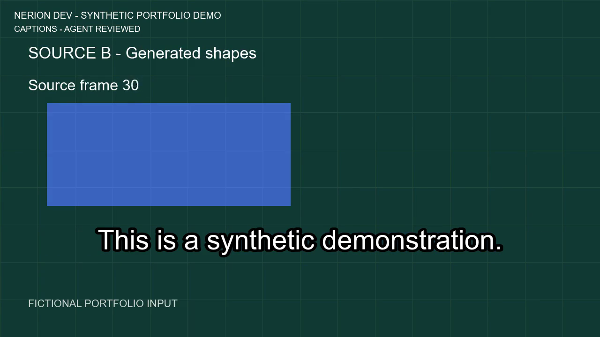

# Nerion Video Flow

Repeatable local video preparation with Python and FFmpeg: trim and join clips,
add narration and music, generate automatic captions, and export a consistent
1280×720 video. No paid API is used by the renderer.

[Watch the reviewed example](example-output/reviewed.mp4) ·
[Compare the raw automatic captions](example-output/raw.mp4)

The example uses generated shapes, an original script, synthetic Flite KAL
speech and generated tones. Its visible frame counters show the actual cuts.
It contains no client footage or the account owner's voice.

The automatic transcript made two word errors. The raw transcript is preserved;
the reviewed example labels the separate agent correction. This is one English
synthetic case, with no production accuracy or monthly-volume claim.

- JSON jobs describe the clips and timing.
- Local inputs and new output directories are checked before rendering.
- Receipts record model, source and media hashes, stages and full decode checks.
- Nine boundary tests accompany the recorded end-to-end runs on Windows.

See [setup, reproduction and limitations](README.txt),
[component attribution](THIRD-PARTY.txt), and [the code license](LICENSE.txt).
Code and review were prepared with AI assistance.

[Fresh Windows integration workflow](.github/workflows/demo.yml) ·
[Dependency pins and local reproduction](ci/README.txt)

The workflow runs new raw and reviewed renders with real local Whisper ASR,
checks their provenance and decodes both outputs. A green run is evidence for
the tested synthetic case; it does not establish accuracy on client footage.

Current validation: 14 tests and both complete renders pass on the development
Windows PC. On the standard hosted Windows runner, the same pinned FFmpeg build
currently exits during ASR with `3221225477 (0xc0000005)`.
[Observed hosted failure](https://github.com/3Nerion7/nerion-video-flow/actions/runs/40050614064).
The cause remains unresolved; hosted rendering is not validated. The workflow
keeps this failure visible instead of accepting a cached or manual transcript.
